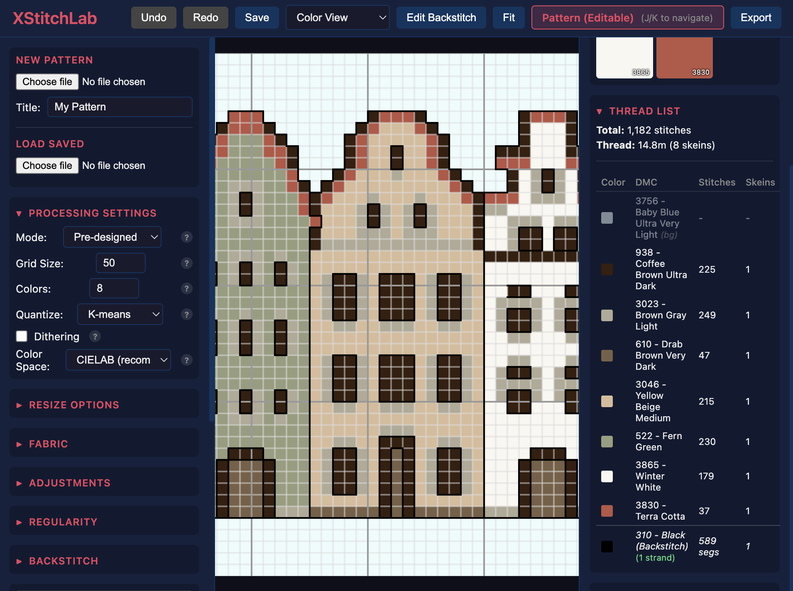

# XStitchLab

A cross-stitch pattern design tool with an end-to-end pipeline: from image to stitchable pattern with DMC thread mapping, previews, and PDF export.



## What it does

XStitchLab turns a picture into a stitchable cross-stitch kit. Each design lives in its own folder
under `designs/` (source image, brief, recipe, pattern). A **recipe** is an ordered list of
operations — quantize the image, pixelate it onto a stitch grid, clean up stray stitches, generate
backstitch — that you can tweak and re-run, previewing every step. The result is a pattern mapped
to real DMC thread colours that you finish by hand in the browser editor and export as a printable
pattern sheet, PDF, PNG previews or JSON, with thread quantities per colour.

### Workflow

**Brief &rarr; Recipe &rarr; Edit &rarr; Export**

1. **Brief** — describe the design and attach the source image (`prompt.md`, `input.png`).
2. **Recipe** — build the op list, run it, and step through the preview of each op.
3. **Edit** — paint, fill, select and backstitch on the pattern canvas; undo/redo; save.
4. **Export** — pattern sheet (HTML), PDF, colour/symbol/realistic PNGs, canonical JSON.

## Getting started

### Prerequisites

- Python 3.11+ and [uv](https://github.com/astral-sh/uv)
- Node.js 18+ (for the frontend)

### Quick start

```bash
git clone https://github.com/tomekhotdog/XStitchLab.git
cd XStitchLab

uv sync --all-packages          # core package + backend (uv workspace)
cd frontend && npm install && cd ..

./run-dev.sh                    # backend on :8000, frontend on :5173
```

Open http://localhost:5173. API docs are at http://localhost:8000/docs.
`./run-backend.sh` and `./run-frontend.sh` start the servers individually; logs go to `logs/`.

The editor works directly on the design folders in `designs/`: **Save rewrites that design's `design.json` and
regenerates its `design.md`**, and exports are written into the folder. Git is the undo. The five finished
Hanseatic designs are also the benchmark's ground truth (`tests/test_benchmark.py`), so an edit to one of them
can move its score. To experiment without touching them, point the backend at a copy:

```bash
cp -r designs /tmp/xstitch-designs && XSTITCH_DESIGNS_DIR=/tmp/xstitch-designs ./run-dev.sh
```

If a design changed on disk after you opened it (another tab, or the CLI), Save is refused and asks you to reload.

### CLI

```bash
uv run xstitch run designs/<slug>                  # run the design's recipe over its input.png
uv run xstitch export designs/<slug> --kind sheet  # sheet | pdf | png-color | png-symbol | png-realistic | json
uv run xstitch benchmark                           # score every design's recipe against its committed pattern
```

`uv run xstitch --help` lists the rest (`convert`, `estimate`, `palette`, ...).

## Tests

```bash
uv run pytest                                  # Python: core, ops, library, backend
cd frontend && npm test && npm run e2e         # Vitest unit tests, then the Playwright smoke test
```

The e2e test starts its own backend (port 8001) and frontend (port 5174) against a throwaway copy
of one design, so it never touches `designs/` or a running dev session.

## Project structure

```
xstitchlab/              Core Python package
├── core/                Pattern model, image input, pixelation, DMC colour mapping, backstitch
├── ops/                 Recipe operations (one module per op) and the op registry
├── library/             Design folders: design.json / design.md / exports
├── export/              Pattern sheet, PDF, PNG and thread-quantity exports
├── prompts/             Brief/prompt templates
└── cli.py               `xstitch` command
backend/app/             FastAPI app (routes/designs.py, routes/ops.py) over the library and ops
frontend/src/
├── api/                 Typed API client
├── model/               Grid, segments and thread maths
├── store/               Zustand editor store (recipe, pattern, undo/redo, save)
├── canvas/              Layered pattern canvas and editing tools
├── components/          Panels, toolbar, recipe cards, dialogs
├── pages/               Library and Editor
├── hooks/               Keyboard shortcuts
└── styles/
frontend/e2e/            Playwright smoke test
tools/benchmark.py       Recipe-vs-final-pattern benchmark
designs/<slug>/          One folder per design: input.png, prompt.md, design.json, design.md, exports
website/                 Static marketing site
```

## Background

XStitchLab started as a tool to generate cross-stitch kits featuring historic Hanseatic architecture — medieval trading cities like Riga, L&uuml;beck, and Bergen. The pipeline is general-purpose and works with any image or theme.

Visit [xstitchlabs.com](https://xstitchlabs.com) to learn more.

## Licence

MIT
